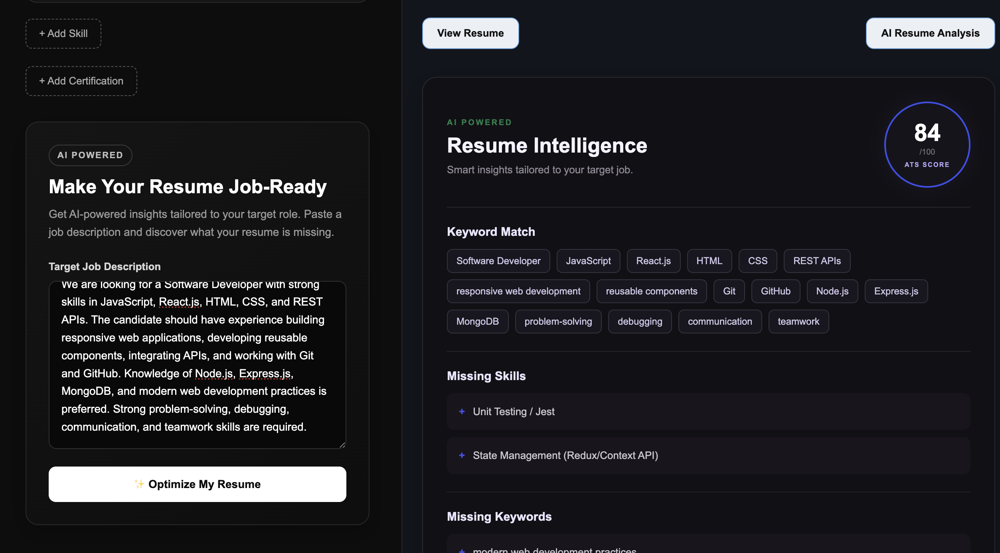
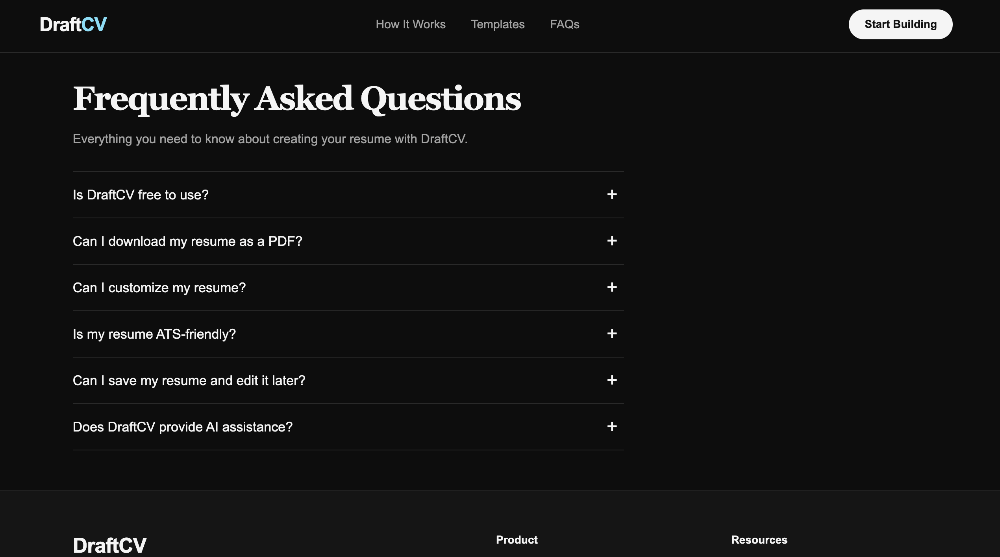
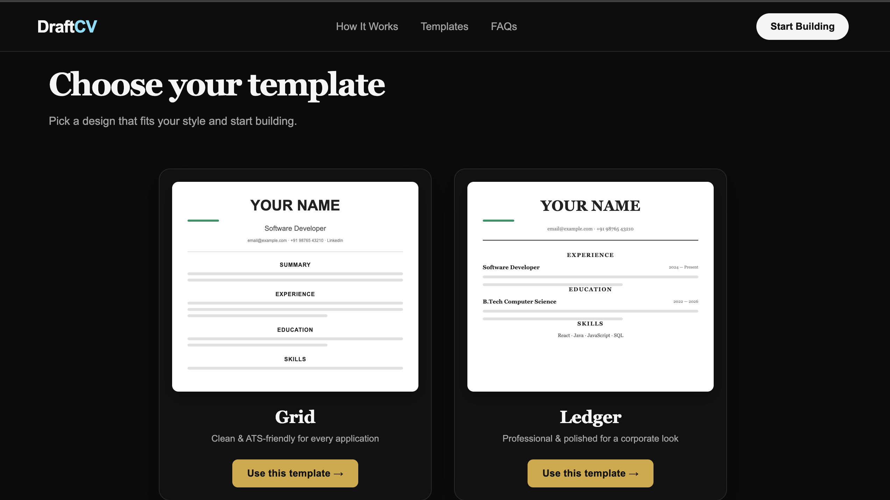

# DraftCV 🚀

DraftCV is an AI-powered resume builder built with React that helps users create professional, ATS-friendly resumes quickly and efficiently.

Users can enter their resume information, choose from different templates, preview their resume in real time, customize spacing, analyze their resume using AI, and download the final resume as a PDF.

## ✨ Features

- 📝 Create and edit resumes easily
- 🎨 Multiple professional resume templates
- 👀 Real-time resume preview
- 📄 Automatic A4 page pagination
- 📥 Download resume as PDF
- 💾 Save resume data using LocalStorage
- 🤖 AI-powered resume analysis
- 📊 ATS-oriented resume suggestions
- ✨ AI-based resume refinement
- 📱 Responsive design
- 🌙 Professional dark-themed interface
- ➕ Add and remove dynamic resume sections
- ⚙️ Custom spacing and formatting controls

## 📌 Resume Sections

DraftCV supports the following sections:

- Personal Information
- Professional Summary
- Work Experience
- Education
- Projects
- Skills
- Certifications

## 🛠️ Tech Stack

### Frontend
- React
- JavaScript
- HTML
- CSS

### Libraries & Tools
- React Router
- React Hook Form
- html2canvas
- jsPDF
- Vite
- LocalStorage

### AI Integration
- AI-powered resume analysis
- Resume improvement suggestions
- ATS-focused recommendations

## 🏗️ Project Structure

```text
DraftCV/
├── src/
│   ├── assets/
│   ├── components/
│   ├── pages/
│   ├── App.jsx
│   ├── App.css
│   ├── index.css
│   └── main.jsx
│
├── public/
├── index.html
├── package.json
└── README.md

🚀 Getting Started
1. Clone the repository
git clone https://github.com/devanshi-29/DraftCV
2. Navigate to the project
cd DraftCV
3. Install dependencies
npm install
4. Start the development server
npm run dev

---Link for the website----
https://draftcv-beta.vercel.app/

💡 How It Works
Enter your personal and professional information.
Add experience, education, projects, skills, and certifications.
Select a resume template.
Preview the resume in real time.
Analyze the resume using AI.
Apply suggested improvements.
Download the final resume as a PDF.
🎯 Project Goals

The main goal of DraftCV is to simplify the resume-building process while helping users create resumes that are:

Professional
Well-structured
ATS-friendly
Easy to customize
Ready to download and share
🔮 Future Improvements
User authentication
Cloud-based resume storage
More resume templates
Job Description matching
Advanced ATS scoring
Resume version management
Export to additional formats
Job-specific AI resume optimization


📷 Screenshots

### Home Page


### Resume Builder


### ATS Analysis


###FAQs


### Templates Section


### How It Works


-- Author --

Devanshi

Built as a React-based AI Resume Builder project to explore modern frontend development, resume generation, PDF processing, and AI integration.

⭐ If you found this project useful, consider giving it a star!